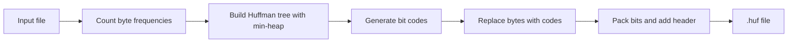

# 🗜️ Huffman File Compressor

A small, beginner-friendly file compressor written in pure Python using **Huffman coding**.
One file, about 100 lines, no external libraries, only `heapq`, `sys`, `os` and `collections.Counter` from the standard library.

```
python MiniProject.py compress   notes.txt  notes.huf     # 35,149 → 20,634 bytes
python MiniProject.py decompress notes.huf  notes_back.txt # identical to the original
```

---

## 📚 Table of Contents

1. [The Concept](#-the-concept)
2. [The Algorithm](#-the-algorithm)
3. [Worked Example](#-worked-example)
4. [How the Program Works](#-how-the-program-works)
5. [Compressed File Format](#-compressed-file-format)
6. [Usage](#-usage-windows)
7. [What Files Compress Well?](#-what-files-compress-well)
8. [Complexity](#-complexity)
9. [Limitations](#-limitations)
10. [Ideas for Improvement](#-ideas-for-improvement)

---

## 💡 The Concept

Normally every byte in a file takes **8 bits**, no matter how often it appears.
But in real files, some bytes show up far more than others. In English text, the letter `e` and the space character are everywhere, while `z` and `q` are rare.

**Huffman coding** exploits this:

> Give **frequent** bytes **short** bit codes and **rare** bytes **long** bit codes.

The total number of bits drops, so the file gets smaller, and **no information is lost**. It is *lossless* compression, so you get back the exact original file.

The codes are also **prefix-free**: no code is the start of another code. That means the decoder can read a stream of bits without any separators and never get confused.

---

## 🧠 The Algorithm

### Compression

1. **Count** how many times each byte value (0–255) appears in the file.
2. Put every byte into a **min-heap** (priority queue) ordered by frequency.
3. Repeat until only one item is left:
   - Remove the **two least frequent** items.
   - Join them into a new node whose frequency is their **sum**.
   - Push the new node back into the heap.
4. The last remaining node is the root of the **Huffman tree**.
5. Walk the tree to build codes: going **left** adds `0`, going **right** adds `1`. The path to a leaf is that byte's code.
6. Replace every byte in the file with its code, pack the bits into bytes, and write them out together with a small header.

### Decompression

1. Read the header and recover the frequency table.
2. Rebuild the **exact same tree** (same table, same order, same tie-breaking).
3. Read the bits one at a time. As soon as the bits collected so far match a code, output that byte and start over.




---

## 🔍 Worked Example

Compress the text `AAAABBC` (7 bytes = 56 bits).

**Step 1: frequencies:** `A = 4`, `B = 2`, `C = 1`

**Step 2: build the tree.** Merge the two smallest (`C` and `B`) into a node of weight 3, then merge that with `A`:

```
          (7)
         0/  \1
        (3)   A
       0/ \1
       C   B
```

**Step 3: codes**

| Byte | Frequency | Code | Bits used |
|:----:|:---------:|:----:|:---------:|
| `A`  | 4 | `1`  | 4 × 1 = 4 |
| `B`  | 2 | `01` | 2 × 2 = 4 |
| `C`  | 1 | `00` | 1 × 2 = 2 |

**Step 4: encode**

```
A A A A B  B  C
1 1 1 1 01 01 00   →   1111010100   (10 bits instead of 56)
```

The most common letter got the shortest code, which is the whole idea. (On a tiny input like this, the header costs more than it saves. The gain shows up on larger files.)

---

## ⚙️ How the Program Works

| Function | Job |
|---|---|
| `build_codes(freq)` | Builds the Huffman tree with a min-heap and returns `{byte: "bit-string"}` |
| `compress(src, dst)` | Counts bytes, encodes the file, writes the header and the packed bits |
| `decompress(src, dst)` | Reads the header, rebuilds the tree, decodes the bits back into bytes |

Small details that make it robust:

- **Works on raw bytes** (`"rb"` / `"wb"`), so any file type is supported, not just text.
- **Heap tie-breaker:** each heap item is `(frequency, unique_id, node)`. The unique id means Python never has to compare two tree nodes, and the tree is built the same way every time.
- **Padding:** the bit stream is padded with zeros to a whole number of bytes. The header remembers how many were added so the decoder can drop them.
- **Edge cases handled:** an empty file, and a file made of only one repeated byte (which would otherwise get an empty code).

---

## 📦 Compressed File Format

| Position | Size | Meaning |
|:--------:|:----:|---------|
| Byte 0 | 1 byte | Number of unique byte values, minus 1 |
| Byte 1 | 1 byte | Number of padding bits at the end |
| Next `5 × N` bytes | 5 bytes each | For each unique byte: its value (1 byte) and its frequency (4 bytes) |
| Rest of file | variable | The compressed bit stream |

The header is at most `2 + 5 × 256 = 1,282` bytes, so it matters for tiny files and is negligible for large ones.

---

## 🚀 Usage (Windows)

Open the project folder, click the address bar, type `cmd` and press Enter. Then:

```bash
# Compress
python MiniProject.py compress  input.txt  output.huf

# Decompress
python MiniProject.py decompress output.huf  restored.txt

# Verify the restored file is identical (prints "no differences encountered")
fc.exe /b input.txt restored.txt
```

> If `python` isn't recognized, try `py` instead.
> If a name contains spaces, put it in quotes: `"my file.txt"`.

Compressing prints the result, for example:

```
35149 -> 20634 bytes (58.7% of original)
```

---

## 📊 What Files Compress Well?

Huffman coding only helps when some bytes are used much more often than others. Files that are **already compressed** have almost perfectly even byte usage, so there is nothing left to squeeze.

### ✅ Good candidates

| File type | Examples | Expected reduction | Why |
|---|---|:---:|---|
| Plain text | `.txt`, `.md`, `.log` | **~35–45%** | Letters and spaces are very uneven |
| Source code | `.py`, `.java`, `.c`, `.js`, `.html`, `.css` | **~30–45%** | Lots of repeated keywords, spaces and punctuation |
| Structured data | `.csv`, `.json`, `.xml`, `.sql` | **~30–50%** | Repeated symbols, digits and tags |
| Uncompressed images | `.bmp` (flat-color art does best) | **~10–60%** | Raw pixels, often with few distinct colors |

### ⚠️ Mixed results

| File type | Examples | Expected reduction | Why |
|---|---|:---:|---|
| Raw audio | `.wav` | **~5–25%** | Depends heavily on the recording |
| Programs | `.exe`, `.dll` | **~10–25%** | Mix of code and data, partly repetitive |

### ❌ Not worth it

| File type | Examples | Expected reduction | Why |
|---|---|:---:|---|
| Compressed images | `.jpg`, `.png`, `.gif`, `.webp` | **~0%** | Already use Huffman or similar inside |
| Compressed audio/video | `.mp3`, `.mp4`, `.mkv` | **~0%** | Already compressed |
| Archives | `.zip`, `.rar`, `.7z`, `.apk` | **~0%** | Already compressed |
| Office files | `.docx`, `.xlsx`, `.pptx` | **~0%** | These are zip archives inside |
| PDFs | `.pdf` | **~0–5%** | Usually compressed internally |

> The ranges above are typical estimates and vary from file to file.

### 🧪 Measured results

| File | Original | Compressed | Result |
|---|---:|---:|---|
| GPL license text (`.txt`) | 35,149 B | 20,634 B | **41% smaller** ✅ |
| This project's source (`.py`) | 3,149 B | 2,155 B | **32% smaller** ✅ |
| JPEG photo (`.jpg`) | 292,349 B | 290,037 B | 0.8% smaller ❌ |
| `goku.jpg` | 3,715,783 B | 3,715,674 B | ~0% smaller ❌ |

---

## ⏱️ Complexity

Let **n** be the file size in bytes and **k** the number of unique bytes (at most 256).

| Step | Time |
|---|:---:|
| Count frequencies | O(n) |
| Build the tree (heap operations) | O(k log k) |
| Encode the file | O(n) |
| Decode the file | O(n) |

Because k ≤ 256 is a small constant, the whole program is effectively **linear in the file size**.

---

## 🚧 Limitations

- **Loads the whole file into memory** and builds a long bit string, so it suits files up to a few MB. Very large files will be slow and memory-hungry.
- **Byte-by-byte only.** It doesn't spot repeated *sequences* (like the word `the` appearing many times), which is why real tools such as ZIP do better.
- **Tiny files can grow**, because the header can cost more than the savings.
- **Frequencies are stored in 4 bytes**, so a single byte value can't appear more than about 4 billion times.

---

## 🔮 Ideas for Improvement

- **Run-Length Encoding (RLE)** before Huffman, which helps images and files with long repeated runs.
- **Canonical Huffman codes**, so the header only stores code lengths instead of full frequencies.
- **Streaming I/O**, reading and writing in chunks instead of loading the whole file.
- **LZ77 + Huffman**, the combination behind ZIP and gzip (known as DEFLATE).

---

## 📁 Project Structure

```
.
├── MiniProject.py   # the whole compressor/decompressor
└── README.md
```

Made with Python 🐍 and a priority queue.
